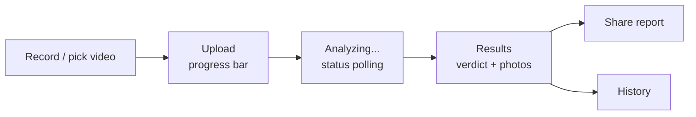

# Helmet Check: Mobile App

Android app for helmet compliance checks. Record a short video in HD or pick one from the gallery, and the AI backend tells you **who is not wearing a helmet**, with a photo and timestamp for every person.


> **Backend:** [helmet-detection](https://github.com/Samarjitkashyp/helmet-detection) (FastAPI + YOLOv8 + admin dashboard). This app is its client.

## Features

- **In-app HD camera**: 1080p / 30 fps, tap-to-focus, pinch zoom, torch, live low-light hint, 2-minute auto-stop.
- **Live detection boxes**: green (helmet) and red (no helmet) boxes drawn on the camera preview before you press record, with a count and a "move closer" hint. They pause while recording because the Android camera plugin turns the preview 90 degrees if frames are read during recording ([flutter/flutter#180075](https://github.com/flutter/flutter/issues/180075)); the saved video is unaffected. Flip `_liveWhileRecording` in `record_screen.dart` once that is fixed. The model runs on the phone (ONNX Runtime) and is downloaded from the backend on first use, so model updates need no new app release. The boxes are a framing guide; the final result comes from the server.
- **CCTV alerts (admin accounts)**: an Alerts tab lists what the camera monitor found, newest first, with the camera photo, a status card ("monitoring is running / offline"), full-screen zoom, and a "Not a violation" button. It checks for new alerts every 20 seconds while open; Telegram covers the rest. Real push notifications need a Firebase project (see the backend's `deploy/README_DEPLOY.md`).
- **Gallery upload**: size check before upload, with clear messages.
- **Live progress**: upload progress, then background analysis with automatic status polling.
- **Clear verdict**: one-glance result (safe / violations), counts, and filters.
- **Photo evidence**: full-screen viewer with swipe and zoom, confidence and timestamp per person.
- **Quality hints**: warns when the video was too dark or the model was unsure.
- **Share report**: send the summary and photos via WhatsApp, email, etc.
- **History**: all analyses with status badges, delete with confirmation.
- **Accounts**: register / sign in with JWT, session kept across restarts.
- **Polish**: onboarding, light and dark themes, Material 3.

## Flow



## Tech stack

| Area | Package |
|---|---|
| UI | Flutter, Material 3 |
| Navigation | `go_router` |
| State | `provider` |
| Networking | `dio` |
| Camera / picker | `camera`, `image_picker` |
| On-device AI | `onnxruntime` (YOLOv8 ONNX, downloaded from the backend) |
| Storage | `shared_preferences` |
| Sharing | `share_plus`, `path_provider` |

## Project structure

```
lib/
  main.dart            entry point, dependency setup
  app.dart             router and auth/onboarding redirects
  app_theme.dart       light and dark themes, status colours
  core/
    api.dart           REST client (auth, upload, status, results)
    auth_state.dart    login state and onboarding flag
    models.dart        video, detection and result models
    limits.dart        upload size cap and recording bitrate
  live/
    live_detector.dart    YUV frame -> model input, ONNX inference, box decoding + NMS
    model_store.dart      downloads / updates the on-device model from the backend
    boxes_overlay.dart    paints the boxes over the camera preview
  screens/
    welcome_screen.dart   onboarding
    login_screen.dart     sign in / register
    home_shell.dart       dashboard and navigation
    record_screen.dart    HD camera
    upload_screen.dart    upload with progress
    results_screen.dart   verdict, filters, photo viewer, share
    events_screen.dart    CCTV alerts (admin accounts)
    history_screen.dart   past analyses
    server_dialog.dart    change server address
```

## Getting started

Requires Flutter 3.x with the Android SDK, and a running [backend](https://github.com/Samarjitkashyp/helmet-detection).

```bash
flutter pub get
flutter run --dart-define=API_URL=http://10.0.2.2:8000     # Android emulator -> backend on your PC
flutter run --dart-define=API_URL=http://<PC-IP>:8000      # real phone on the same WiFi
```

Debug builds allow plain HTTP for local development. The server address can also be changed inside the app (server icon on the home screen, or on the login screen).

## Configuration

| Setting | Where | Notes |
|---|---|---|
| `API_URL` | `--dart-define` at build/run time | Backend base URL, e.g. `https://your-server.example.com` |
| Server address | In-app dialog | Overrides the default at runtime; **Use default** resets it |
| Upload limit / bitrate | `lib/core/limits.dart` | 95 MB cap (stays under common proxy limits), 5 Mbps recording |

## Build a release APK

```bash
flutter build apk --release --split-per-abi --dart-define=API_URL=https://your-server.example.com
```

Output: `build/app/outputs/flutter-apk/app-arm64-v8a-release.apk` (most modern phones). Release builds only talk to **HTTPS** servers.

For the Play Store, create your own keystore and signing config; the template build is signed with the debug key, which is fine for sideloading.

### Distribute without the Play Store

In the backend's admin dashboard (**Settings → Mobile app**), upload the APK (a progress bar shows the upload), then press **Publish**. Users then open `https://your-server.example.com/app` on their phone, tap **Download for Android**, and install it (Android asks to allow "Install unknown apps" once).

## Permissions

| Permission | Why |
|---|---|
| `INTERNET` | Talk to the backend |
| `CAMERA` | Record video (no microphone is used; videos are silent) |

## Limitations

- Android only for now; recording is limited to 2 minutes and uploads to 95 MB.
- Detection accuracy depends on light, distance and focus. Follow the in-app tips for best results.
- Needs an internet connection; analysis runs on the server.
- Live boxes download a ~45 MB model on first use (Wi-Fi recommended), run on ARM phones only (the x86 emulator is not supported), use more battery, and are less exact than the server analysis.
- The recording screen follows how the phone is held (portrait or landscape, either way) using the motion sensor, even if the phone's auto-rotate is off; a lock button keeps it fixed, and it never turns during a recording.

## Roadmap

- iOS build
- Hindi / English language switch
- Push notification when analysis completes
- Offline queue for uploads

## License

[MIT](LICENSE)

## Author

[Samarjitkashyp](https://github.com/Samarjitkashyp)
